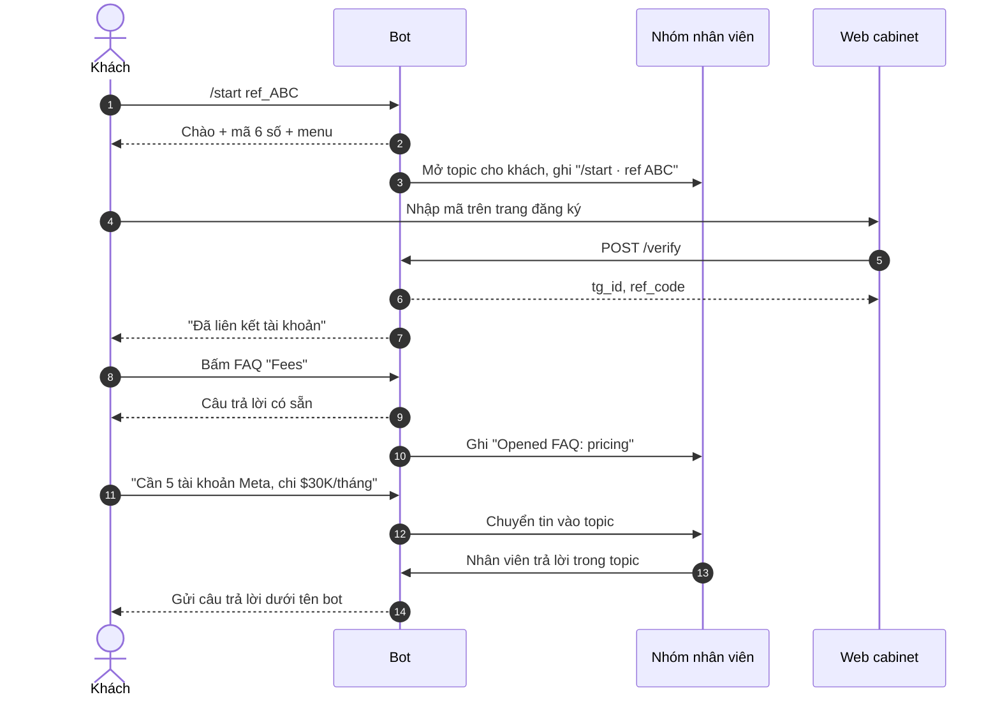

# Bot khách hàng FunAgency: mô tả cho BA và dev

> **Trạng thái:** bản đầu đã có trong `bot/` (nhánh `claude/kind-hawking-plfzjx`), chưa chạy với Telegram thật.
> **Đọc phần nào:** BA đọc mục 1–7 và 11. Dev đọc thêm mục 8–10.

## 1. Tóm tắt

Chúng ta làm một bot Telegram (`@funagency_bot`) làm cửa vào duy nhất cho khách thuê tài khoản quảng cáo. Bot làm ba việc:

1. **Định danh khách:** gửi mã 6 số để khách liên kết Telegram với tài khoản web, và ghi lại ai giới thiệu khách.
2. **Tự tư vấn:** trả lời ngay các câu hỏi lặp lại (nền tảng, phí, nạp tiền, thay tài khoản, ngách cấm, chương trình giới thiệu).
3. **Hỗ trợ ẩn danh:** khách nhắn bot, cả đội hỗ trợ cùng trả lời trong một nhóm nội bộ, khách chỉ thấy tên bot.

**Mục tiêu kinh doanh:** khách thuộc về công ty chứ không thuộc về tài khoản Telegram cá nhân của một nhân viên; mỗi khách mới đều được người thật tiếp cận nhanh; và có dữ liệu để đo phễu từ landing tới khách trả tiền.

## 2. Bối cảnh: vì sao làm

**Hiện tại:**
- Landing `funref.com` dẫn khách vào bot qua link `t.me/funagency_bot?start=ref_…`.
- Muốn hỏi thì khách nhắn tài khoản cá nhân `@nil_ad01`.
- README của landing ghi "No analytics": không biết bao nhiêu người bấm vào rồi bỏ đi.

**Vấn đề:**

| Vấn đề | Hậu quả |
|---|---|
| Khách nói chuyện với tài khoản cá nhân | Nhân viên nghỉ việc là mất khách và mất lịch sử trao đổi |
| Một người trực một tài khoản | Không chia ca được, người đó bận là khách phải chờ |
| Không có định danh chung giữa web và Telegram | Không biết khách trên web là ai trên Telegram; không gửi được thông báo nạp tiền |
| Câu hỏi lặp lại trả lời bằng tay | Tốn thời gian sales, trả lời không thống nhất |
| Không đo phễu | Không biết nên sửa bước nào |

**Tham khảo đối thủ:** Cabinet Partners (`cabinet.partners`) đã làm mô hình này: mã kích hoạt qua bot, tạo sẵn nhóm riêng cho từng khách với sales và bot, nhân viên trả lời dưới tên công ty. Phân tích chi tiết nằm trong trang phân tích Cabinet. Chúng ta lấy phần hay, sửa phần dở:
- nói rõ cho khách biết đội hỗ trợ đọc tin nhắn;
- không giấu số bước đăng ký.

## 3. Mục tiêu và cách đo

Các con số dưới đây là **đề xuất**. BA cần lấy số hiện tại (baseline) trước khi chốt.

| Mục tiêu | Chỉ số | Đề xuất |
|---|---|---|
| Khách mới được tiếp cận nhanh | Thời gian từ tin nhắn đầu của khách tới câu trả lời đầu tiên của người thật, trong giờ làm việc | Trung vị dưới 5 phút |
| Khách không phụ thuộc cá nhân | % hội thoại hỗ trợ đi qua bot thay vì tài khoản cá nhân | 100% sau 1 tháng |
| Bớt việc lặp lại | % khách mở FAQ mà không cần hỏi người trong 24 giờ sau đó | Theo dõi, chưa đặt mục tiêu |
| Định danh đầy đủ | % khách web đã liên kết Telegram | Trên 90% khách trả tiền |
| Ghi nhận giới thiệu đúng | % khách có mã ref được lưu khi đến từ link ref | 100% |
| Đo được phễu | Có số liệu cho: bấm link → /start → nhắn tin → liên kết web → nạp tiền lần đầu | Có báo cáo hằng tuần |

## 4. Phạm vi

**Trong phạm vi (đã làm ở bản đầu):**
- `/start` có hoặc không có mã giới thiệu, `/code`, `/menu`.
- Mã 6 số và API `POST /verify` cho web.
- Menu tự tư vấn tiếng Anh và tiếng Nga.
- Chuyển tin giữa khách và nhóm nhân viên (mỗi khách một topic), trả lời ẩn danh, ghi chú nội bộ, đóng và mở lại hội thoại.
- Nhóm khách tạo bằng tay có thêm bot: tin trong nhóm cũng được chuyển.

**Ngoài phạm vi bản này (backlog, xem mục 10):**
- Tự tạo nhóm riêng cho từng khách.
- Web cabinet: form đăng ký, dashboard, thanh toán. Demo giao diện đã có, backend chưa có.
- Thông báo nạp tiền và trạng thái tài khoản.
- Báo cáo phễu.
- Bot giới thiệu `@fun_referrer_bot`: giữ nguyên, không đụng tới.

## 5. Người dùng và vai trò

| Vai trò | Là ai | Làm gì với bot |
|---|---|---|
| Khách | Media buyer, team chạy quảng cáo | `/start`, lấy mã, xem FAQ, nhắn hỏi, nhận trả lời |
| Nhân viên hỗ trợ / sales | Mia, người trực ca | Trả lời trong topic, ghi chú nội bộ, gửi FAQ, đóng hội thoại |
| Trưởng nhóm hỗ trợ | Quản lý nhóm nhân viên | Quyết định ai trong nhóm nhân viên, xem lịch sử, đặt quy tắc ký tên |
| Người giới thiệu | Người có link `ref_…` | Không dùng bot này trực tiếp; được ghi nhận khi khách bấm link của họ |
| Web cabinet | Hệ thống | Gọi `POST /verify` để liên kết tài khoản |

## 6. User story và tiêu chí nghiệm thu

**US1. Lấy mã đăng ký**
Là khách, tôi muốn nhận mã từ bot để liên kết Telegram với tài khoản web.
- Gửi `/start` thì nhận lời chào, mã 6 số, cảnh báo bảo mật (chỉ lần đầu) và menu.
- Mã dùng được trong 15 phút và chỉ một lần.
- `/code` cấp mã mới và làm mã cũ hết hiệu lực.
- Xin mã liên tục trong vòng 30 giây thì bot báo phải chờ bao nhiêu giây, không im lặng.

**US2. Ghi nhận người giới thiệu**
Là chủ chương trình giới thiệu, tôi muốn mỗi khách đến từ link ref được gắn đúng người giới thiệu.
- `/start ref_ABC` lưu `ABC` cho khách đó.
- Khách bấm link ref khác sau đó thì **giữ mã đầu tiên** (first-touch).
- Mã ref hiện trong topic của khách và được trả về cho web qua `/verify`.

**US3. Tự tư vấn**
Là khách, tôi muốn có câu trả lời ngay cho câu hỏi thường gặp.
- Menu có 6 chủ đề cùng nút "Talk to a manager".
- Khách dùng Telegram tiếng Nga thì nhận nội dung tiếng Nga, còn lại tiếng Anh.
- Số liệu trùng với landing và `terms.html`.
- Khách mở chủ đề nào thì nhân viên thấy trong topic (nếu topic đã tồn tại).

**US4. Hỏi người thật**
Là khách, tôi muốn nhắn câu hỏi và được người trả lời ngay trong chat với bot.
- Tin nhắn đầu nhận phản hồi "Got it. A manager will reply in this chat."
- Mọi loại tin (chữ, ảnh, file, voice) đều tới nhóm nhân viên.
- Câu trả lời tới từ bot; khách không thấy tên hay tài khoản của nhân viên.
- Khách trả lời (reply) vào một tin của bot thì nhân viên thấy khách đang trả lời tin nào.

**US5. Trả lời ẩn danh**
Là nhân viên hỗ trợ, tôi muốn trả lời khách trong một chỗ chung mà không lộ tài khoản cá nhân.
- Mỗi khách có đúng một topic, tên gồm tên, @username và ID.
- Đầu topic có thẻ thông tin: ngôn ngữ, mã ref, tài khoản web.
- Tin trong topic được gửi cho khách. Tin bắt đầu bằng `//` thì không gửi.
- Admin đăng ẩn danh trong nhóm vẫn trả lời được.
- Khách đã chặn bot thì topic hiện cảnh báo "Not delivered".
- `/alias Mia` để ký tên cuối tin chữ; `/alias off` để bỏ.

**US6. Đóng hội thoại**
Là nhân viên, tôi muốn đóng hội thoại đã xong cho gọn danh sách.
- `/close` đóng topic và báo khách.
- Khách nhắn lại thì topic tự mở lại.

**US7. Liên kết web**
Là web cabinet, tôi muốn kiểm tra mã khách nhập và biết họ là ai trên Telegram.
- `POST /verify` với mã đúng trả về `tg_id`, `username`, `first_name`, `ref_code`.
- Mã sai, đã dùng hoặc hết hạn thì trả lỗi 400.
- Sai khoá bí mật thì trả lỗi 401.
- Thành công thì bot báo khách đã liên kết, topic ghi số tài khoản web.

## 7. Luồng chính



## 8. Thiết kế kỹ thuật (dev)

**Công nghệ:**
- Node.js 22.13 trở lên.
- [grammY](https://grammy.dev) để nói chuyện với Telegram, chạy long polling nên không cần URL công khai.
- SQLite có sẵn trong Node (`node:sqlite`), file mặc định `data/bot.db`.

**Cấu trúc `bot/`:**

| File | Nhiệm vụ |
|---|---|
| `src/index.js` | Khởi động bot và API, đăng ký lệnh, dừng an toàn |
| `src/config.js` | Đọc biến môi trường, thiếu biến bắt buộc thì dừng |
| `src/db.js` | Schema và truy vấn SQLite |
| `src/otp.js` | Cấp và kiểm tra mã 6 số |
| `src/texts.js` | Toàn bộ nội dung gửi khách, EN và RU |
| `src/relay.js` | Chuyển tin khách ↔ nhóm nhân viên |
| `src/bot.js` | Gắn lệnh, nút, tin nhắn vào các module trên |
| `src/api.js` | HTTP API cho web cabinet |
| `test/` | 32 test chạy bằng `npm test` |

**Cơ chế ẩn danh:**
- Khách → nhân viên dùng `forwardMessage`, để nhân viên thấy ai viết.
- Nhân viên → khách dùng `copyMessage`, bản sao không mang thông tin người gửi gốc nên khách chỉ thấy bot.
- Có alias thì gửi `sendMessage` với chữ ký nối vào cuối; định dạng giữ nguyên vì vị trí các đoạn in đậm, link… không bị xê dịch.

**Dữ liệu:**

| Bảng | Nội dung |
|---|---|
| `users` | `tg_id`, username, tên, ngôn ngữ, `ref_code` (lần đầu), `account_id` (web) |
| `codes` | mã, `tg_id`, hạn, thời điểm dùng |
| `conversations` | `chat_id` (khách hoặc nhóm khách), loại, tiêu đề, `topic_id`, trạng thái |
| `msg_links` | cặp ID tin phía khách ↔ phía nhân viên, để reply trỏ đúng tin |
| `staff_aliases` | chữ ký của từng nhân viên |

**API:**

```
POST /verify
Authorization: Bearer <API_SECRET>
{"code": "482913", "account_id": "acc_1024"}
→ 200 {"ok": true, "tg_id": 111, "username": "alex_arb", "first_name": "Alex", "ref_code": "7KX2"}
→ 400 {"ok": false, "error": "invalid_or_expired_code"}
→ 401 {"ok": false, "error": "unauthorized"}
GET /health → 200
```

**Biến môi trường:** xem `bot/.env.example`:
- `BOT_TOKEN`, `STAFF_CHAT_ID`, `API_SECRET` là bắt buộc;
- `STAFF_IDS`, `API_PORT`, `DB_PATH`, `OTP_TTL_MIN`, `SUPPORT_NAME` là tuỳ chọn.

**Cài đặt Telegram:**
- Tắt Group Privacy của bot nếu muốn đọc tin trong nhóm khách.
- Nhóm nhân viên là supergroup bật Topics, bot là admin có quyền *Manage topics*.

**Vận hành:**
- Chạy một instance (pm2 hoặc systemd).
- Sao lưu `data/bot.db` hằng ngày.
- API chỉ mở cho backend web, qua HTTPS.
- Landing deploy bằng `vercel --prod`; `.vercelignore` đã loại `bot/` ra.

## 9. Quy tắc nghiệp vụ

| Quy tắc | Giá trị | Ở đâu |
|---|---|---|
| Độ dài mã | 6 chữ số | `otp.js` |
| Hạn mã | 15 phút | `OTP_TTL_MIN` |
| Số lần dùng | 1 | `otp.js` |
| Chờ giữa hai lần xin mã | 30 giây | `RESEND_COOLDOWN_MS` |
| Gắn người giới thiệu | Lần đầu, không ghi đè | `db.setRefIfEmpty` |
| Ghi chú nội bộ | Tin bắt đầu bằng `//` | `relay.js` |
| Ngôn ngữ | RU nếu Telegram của khách là `ru*`, còn lại EN | `texts.js` |
| Phí dịch vụ | 4–7% | `texts.js`, landing |
| Thay tài khoản | khoảng 60 giây | `texts.js`, landing |
| Hoa hồng giới thiệu | 1.0% chi tiêu nếu phí khách ≥ 5%, 0.5% nếu dưới 5%; tính sau $10K chi tiêu và 2 tháng hoạt động; giữ 14 ngày; rút từ $20, phí mạng $1 | `texts.js`, `terms.html`, `getRate()` trong `index.html` |

Đổi một con số thì đổi cả ba nơi. Test kiểm tra phần hoa hồng khớp với `terms.html`.

## 10. Trạng thái và backlog

**Đã xong:**
- Toàn bộ mục 6.
- 32 test, gồm 9 test chạy handler thật với tin nhắn giả lập.

**Chưa kiểm tra:** chưa chạy với Telegram thật.

**Backlog đề xuất (theo thứ tự):**

| # | Việc | Ai | Ghi chú |
|---|---|---|---|
| 1 | Chạy thử với token thật và nhóm nhân viên thật | Dev + hỗ trợ | Kiểm tra mục 6 bằng tay |
| 2 | Chuyển hỗ trợ từ `@nil_ad01` sang bot | Business | Thông báo cho khách cũ, sửa link trên landing |
| 3 | Đo phễu: đếm bấm link, `/start`, tin đầu, liên kết, nạp tiền | Dev + BA | BA định nghĩa sự kiện |
| 4 | Web cabinet: đăng ký + nhập mã (theo demo) | Dev | Dùng `POST /verify` |
| 5 | Thông báo nạp tiền và trạng thái tài khoản qua bot | Dev | Cần backend thanh toán |
| 6 | Tự tạo nhóm riêng cho từng khách | Dev | Cần một tài khoản người dùng chạy MTProto; rủi ro bị Telegram giới hạn |
| 7 | Gửi lại tin khi khách sửa tin nhắn | Dev | Nhỏ |

## 11. Câu hỏi cần chốt

1. **Tên bot:** `@funagency_bot` có phải bot dùng cho việc này không, hay tạo bot mới?
2. **Giờ làm việc và SLA:** khung giờ trực; ngoài giờ có tự trả lời không?
3. **Ký tên:** trả lời hoàn toàn ẩn danh, hay mỗi khách có một người phụ trách có tên như Mia bên Cabinet?
4. **Ai vào nhóm nhân viên;** ai có quyền xem lịch sử?
5. **Lưu tin nhắn bao lâu.** README landing đã ghi chưa đáp ứng 152-FZ (lưu dữ liệu công dân Nga tại Nga). Cần quyết định trước khi chạy thật.
6. **Ngưỡng chi tiêu cho từng mức phí 4–7%:** bot hiện chỉ nói "4–7%", chưa nói ngưỡng.
7. **Phương thức nạp tiền và mức nạp tối thiểu,** để đưa vào FAQ "Top-up".
8. **Khách cũ** đang ở `@nil_ad01` chuyển sang thế nào?

## 12. Rủi ro

| Rủi ro | Giảm thiểu |
|---|---|
| Khách gửi mật khẩu hoặc mã 2FA vào chat | Cảnh báo ở lần đầu; nhân viên không bao giờ hỏi |
| Lộ khoá API, ai đó liên kết bừa tài khoản | Khoá dài ngẫu nhiên, chỉ backend gọi, qua HTTPS |
| Bot là một điểm hỏng duy nhất | Theo dõi `/health`, tự khởi động lại, sao lưu DB |
| Nhân viên lỡ gửi ghi chú cho khách | Quy ước `//` rõ ràng, nhắc trong thẻ thông tin topic |
| Số liệu trong FAQ lệch với điều khoản | Một chỗ sửa, test kiểm tra |

## 13. Thuật ngữ

- **Topic:** chủ đề con trong supergroup Telegram bật Topics; mỗi khách một topic.
- **Ref / first-touch:** mã người giới thiệu; first-touch là giữ mã của lần đầu khách bấm.
- **OTP:** mã dùng một lần.
- **Ẩn danh:** khách chỉ thấy bot, không thấy tài khoản nhân viên trả lời.
- **Web cabinet:** trang web khách đăng nhập để quản lý tài khoản, nạp tiền; hiện mới có demo giao diện.
