# FunAgency Client Cabinet: mục tiêu, demo, UI/UX và bot

> **Trạng thái (22/10/2026):**
> - Bot Telegram đã viết xong trong `bot/` và có test, nhưng chưa chạy với Telegram thật.
> - Web cabinet mới có demo giao diện, chưa có backend.
>
> **Demo:**
> - Bản online (cần được chia sẻ quyền xem): https://claude.ai/artifact/3ztytzACTHhydYPmV8h3iS
> - Bản trong repo: `docs/demo/onboarding.html`, mở bằng trình duyệt.
>
> **Đọc phần nào:**
> - BA, business, design: mục 1–7 và 13.
> - Dev: đọc thêm mục 8–12.

## 1. Mục tiêu dự án

**Một câu:** khách thuê tài khoản quảng cáo tự đăng ký, liên kết Telegram, chọn mức phí, nạp tiền và nhận tài khoản trong một luồng. Mọi trao đổi đi qua kênh của công ty chứ không qua tài khoản cá nhân của nhân viên.

### 1.1 Mục tiêu kinh doanh

| # | Mục tiêu | Vì sao |
|---|---|---|
| G1 | **Khách thuộc về công ty.** Mọi hỗ trợ đi qua bot và nhóm nhân viên, không qua `@nil_ad01` | Nhân viên nghỉ không mất khách, không mất lịch sử; nhiều người trực chung |
| G2 | **Khách tự phục vụ được** từ đăng ký đến nạp tiền lần đầu | Bớt việc tay của sales, khách không phải chờ người để bắt đầu |
| G3 | **Phản hồi nhanh khách mới.** Người thật tiếp cận ngay khi khách `/start` | Đối thủ (Cabinet Partners) đưa sales vào trong vài giây sau đăng ký |
| G4 | **Đo được phễu** từ landing tới khách trả tiền | Landing hiện không có analytics; không biết rơi khách ở đâu |
| G5 | **Ghi nhận giới thiệu chính xác** | Hoa hồng 1.0% / 0.5% phụ thuộc việc gắn đúng khách với người giới thiệu |

### 1.2 Mục tiêu cho người dùng

- **Khách:** biết ngay giá và điều kiện; đăng ký trong vài phút; được người thật trả lời trong chat quen thuộc (Telegram); thấy số dư và trạng thái tài khoản mà không phải hỏi.
- **Nhân viên hỗ trợ:**
  - Một nơi duy nhất để trả lời mọi khách.
  - Thấy khách đến từ đâu và đã xem gì trước khi trả lời.
  - Không phải dùng tài khoản cá nhân.
- **Người giới thiệu:** khách họ mang đến được ghi nhận ngay từ lần bấm link đầu tiên.

### 1.3 Không phải mục tiêu

- Không làm công cụ chạy quảng cáo (bulk launch, tự động hoá chiến dịch) như phần mềm của Cabinet. FunAgency bán tài khoản và dịch vụ, không bán phần mềm.
- Không thay bot giới thiệu `@fun_referrer_bot` ở giai đoạn này.
- Không nhận thanh toán bằng thẻ ở giai đoạn này.

### 1.4 Chỉ số thành công

Các con số là **đề xuất**; BA cần đo số hiện tại trước khi chốt.

| Mục tiêu | Chỉ số | Đề xuất |
|---|---|---|
| G1 | % hội thoại hỗ trợ đi qua bot | 100% sau 1 tháng chuyển đổi |
| G2 | % khách đăng ký xong mà nạp tiền lần đầu không cần hỏi người | Theo dõi 1 tháng rồi đặt mục tiêu |
| G3 | Thời gian từ tin đầu của khách tới câu trả lời đầu của người thật (giờ làm việc) | Trung vị dưới 5 phút |
| G4 | Báo cáo phễu: bấm link → `/start` → liên kết web → chọn gói → nạp lần đầu | Có báo cáo hằng tuần |
| G5 | % khách đến từ link ref có mã ref được lưu | 100% |

### 1.5 Lộ trình

| Giai đoạn | Nội dung | Trạng thái |
|---|---|---|
| 1. Bot | Mã đăng ký, menu tự tư vấn, hỗ trợ ẩn danh, API `/verify` | Code xong, chờ chạy thật |
| 2. Đăng ký web | Màn W1–W3: tài khoản, team, liên kết Telegram | Demo giao diện |
| 3. Thanh toán | Màn W4–W6: chọn mức phí, hoá đơn USDT, theo dõi giao dịch | Demo giao diện |
| 4. Dashboard | Màn W7–W10: tài khoản, nạp tiền, thay tài khoản, giới thiệu, hỗ trợ | Demo giao diện |
| 5. Nhóm riêng | Tự tạo nhóm Telegram riêng cho từng khách như Cabinet | Chưa làm |

## 2. Bối cảnh

**Hiện tại:**
- Landing `funref.com` dẫn khách vào bot qua link `t.me/funagency_bot?start=ref_…`.
- Muốn hỏi thì khách nhắn tài khoản cá nhân `@nil_ad01`.
- Không đo được gì.

| Vấn đề | Hậu quả |
|---|---|
| Khách nói chuyện với tài khoản cá nhân | Nhân viên nghỉ việc là mất khách và lịch sử |
| Một người trực một tài khoản | Không chia ca được, khách phải chờ |
| Không có định danh chung giữa web và Telegram | Không gửi được thông báo nạp tiền, không biết khách web là ai |
| Câu hỏi lặp lại trả lời bằng tay | Tốn thời gian, trả lời không thống nhất |
| Không đo phễu | Không biết sửa bước nào |

**Tham khảo đối thủ:** Cabinet Partners (`cabinet.partners`) làm mô hình này:
- mã kích hoạt qua bot;
- tạo sẵn nhóm riêng cho từng khách, có sales và bot trong nhóm;
- nhân viên trả lời dưới tên công ty;
- giá phần mềm $40–80/tháng, kèm cho thuê tài khoản với phí 5% chi tiêu.

Chúng ta lấy phần hay và sửa phần dở:
- nói rõ cho khách biết đội hỗ trợ đọc tin nhắn;
- thanh tiến trình hiện đúng số bước;
- có xác minh email.

## 3. Demo

**Mở:** link online ở đầu tài liệu, hoặc file `docs/demo/onboarding.html` trong repo (mở trực tiếp bằng trình duyệt, không cần cài gì).

**Là gì:** web cabinet bấm được từ đầu tới cuối, kèm phần kiến trúc hệ thống ở cuối trang.
- **Toàn bộ dữ liệu là giả:** không gửi đi đâu, không có tiền thật.
- Mã QR và địa chỉ ví có nhãn "DEMO · DO NOT PAY".
- Nút "Làm lại" trên thanh trên cùng đưa demo về bước đầu.

**Kịch bản trình bày (khoảng 3 phút):**

| Bước | Thao tác | Nói gì |
|---|---|---|
| 1 | Nhập mật khẩu 8 ký tự bất kỳ, bấm Continue | Form ngắn, nút chỉ sáng khi hợp lệ |
| 2 | Chọn mức chi tiêu "$10K – $50K", Continue | Mức chi tiêu quyết định mức phí; mã ref điền sẵn từ link |
| 3 | Bấm biểu tượng mở bot, bấm vào mã trong khung chat, Activate | Đây là bước liên kết Telegram; ngoài đời khách nhận mã từ bot thật |
| 4 | Thấy mức Scale bị khoá; giữ Pro 5% | Bậc phí theo chi tiêu, khoá rõ ràng thay vì giấu |
| 5 | Giữ $1,000, chọn TRC-20, "Get payment address" | Thấy ngay phí và tổng phải trả trước khi trả |
| 6 | "Simulate transfer" | Hệ thống tự nhận giao dịch, không cần gửi ảnh chụp cho sales |
| 7 | Xem cửa sổ "You're all set" | Nhóm hỗ trợ riêng và chương trình giới thiệu ngay sau khi trả tiền |
| 8 | Đóng cửa sổ, xem tài khoản chuyển "Issuing" → "Active" | Khách tự thấy trạng thái, không phải hỏi |

**Những gì là số giả cần chốt (mục 13):**
- ngưỡng $10K / $50K cho từng mức phí;
- mức nạp tối thiểu $100;
- hạn mức tài khoản;
- tên nhân viên "Mia";
- địa chỉ ví.

## 4. Phạm vi

| | Trong phạm vi | Ngoài phạm vi |
|---|---|---|
| Bot (giai đoạn 1) | `/start`, `/code`, `/menu`; mã 6 số; menu FAQ EN/RU; hỗ trợ ẩn danh qua nhóm nhân viên; API `/verify` | Tự tạo nhóm cho từng khách; thông báo nạp tiền |
| Web (giai đoạn 2–4) | Các màn W1–W10 ở mục 6 | Thanh toán thẻ; công cụ chạy quảng cáo |
| Khác | Đo phễu | Thay `@fun_referrer_bot` |

## 5. Người dùng và vai trò

| Vai trò | Là ai | Dùng gì |
|---|---|---|
| Khách | Media buyer, team chạy quảng cáo | Web cabinet, chat với bot |
| Nhân viên hỗ trợ / sales | Người trực ca | Nhóm nhân viên trên Telegram (mỗi khách một topic) |
| Trưởng nhóm hỗ trợ | Quản lý nhóm nhân viên | Quyết định ai trong nhóm, quy tắc ký tên |
| Người giới thiệu | Người có link `ref_…` | Được ghi nhận tự động; theo dõi trong màn W9 |
| Web cabinet | Hệ thống | Gọi API bot để liên kết tài khoản |

## 6. UI/UX từng màn

### 6.1 Nguyên tắc chung

1. **Một màn một việc.** Mỗi màn chỉ có một nút chính.
2. **Nút chính chỉ sáng khi đủ điều kiện;** lỗi hiện ngay dưới ô, nói rõ cần sửa gì.
3. **Thanh tiến trình nói thật số bước** (5 bước). Không giấu bước như Cabinet.
4. **Telegram là kênh chính** để liên lạc; web là nơi tự phục vụ.
5. **Tiền luôn rõ trước khi trả:** số dư nhận được, phí, tổng phải trả.
6. **Giao diện:** màu và font theo landing (cam `#f97316`, Inter); có giao diện sáng và tối; dùng được trên điện thoại từ 390px.
7. **Ngôn ngữ:** giao diện EN và RU như landing; bot tự chọn theo ngôn ngữ Telegram của khách.
8. **Bảo mật nói thẳng với khách:** đội hỗ trợ đọc tin nhắn; không bao giờ gửi mật khẩu hay mã 2FA.

Mỗi màn bên dưới có: mục đích, thành phần, quy tắc và trạng thái, sự kiện cần đo (đặt tên gợi ý cho analytics).

### 6.2 Web cabinet

#### W1. Tạo tài khoản

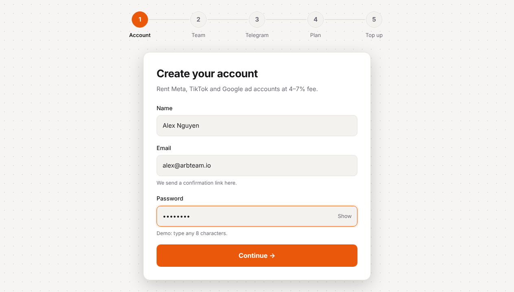

| | |
|---|---|
| Mục đích | Tạo tài khoản web |
| Thành phần | Tên; email; mật khẩu (nút Show/Hide); nút Continue |
| Quy tắc | Email đúng định dạng; mật khẩu tối thiểu 8 ký tự; Continue khoá tới khi hợp lệ |
| Lỗi | "Enter a valid email, like name@team.io" ngay dưới ô email |
| Sau đó | Gửi email xác minh (Cabinet không làm bước này) |
| Sự kiện | `signup_viewed`, `signup_account_submitted` |

#### W2. Team

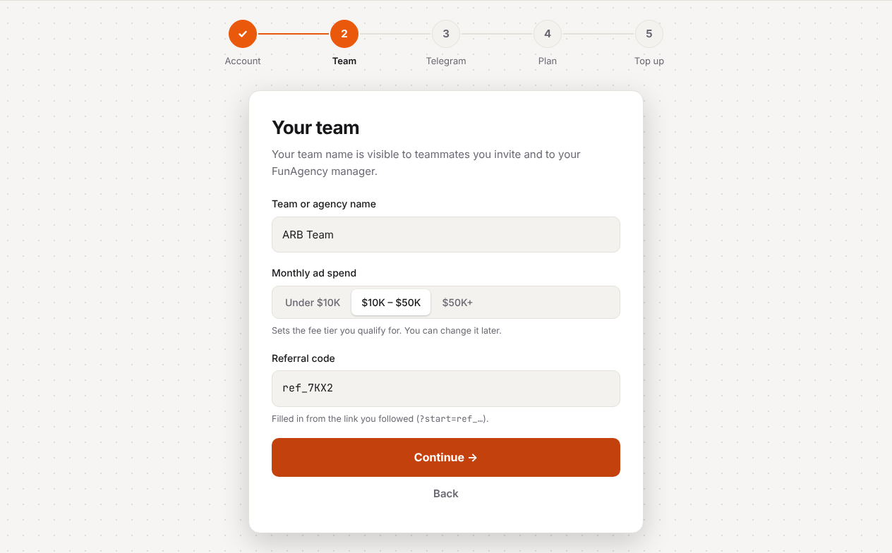

| | |
|---|---|
| Mục đích | Biết khách là team nào, chi tiêu bao nhiêu, ai giới thiệu |
| Thành phần | Tên team; mức chi tiêu/tháng (3 lựa chọn); mã giới thiệu |
| Quy tắc | Tên team từ 2 ký tự; mức chi tiêu quyết định mức phí ở W4; mã ref điền sẵn từ link `?start=ref_…`, khách sửa được |
| Sự kiện | `signup_team_submitted` (kèm `spend_band`, `has_ref`) |

#### W3. Liên kết Telegram

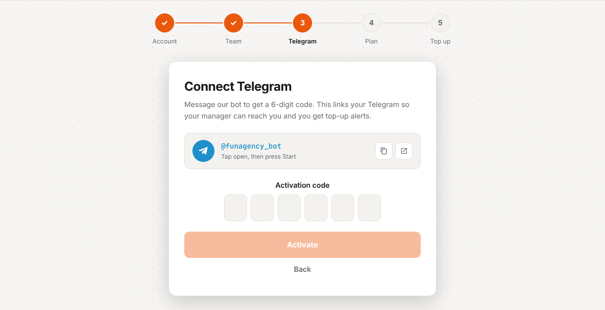

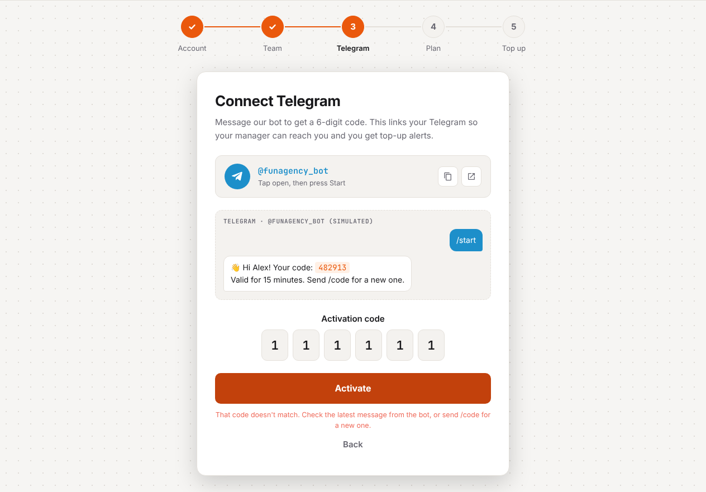

| | |
|---|---|
| Mục đích | Gắn Telegram của khách với tài khoản web để hỗ trợ và gửi thông báo |
| Thành phần | Thẻ bot `@funagency_bot` (nút copy, nút mở bot); 6 ô nhập mã; nút Activate |
| Quy tắc | Gõ số tự nhảy ô; Backspace lùi ô; dán cả mã thì tự điền; Activate sáng khi đủ 6 số |
| Lỗi | Sai, hết hạn hoặc đã dùng: "That code doesn't match. Check the latest message from the bot, or send /code for a new one." |
| Hệ thống | Web gọi `POST /verify` của bot; thành công thì bot nhắn khách "Telegram is linked…" |
| Sự kiện | `tg_bot_opened`, `tg_code_submitted`, `tg_code_failed`, `tg_linked` |

#### W4. Nền tảng và mức phí

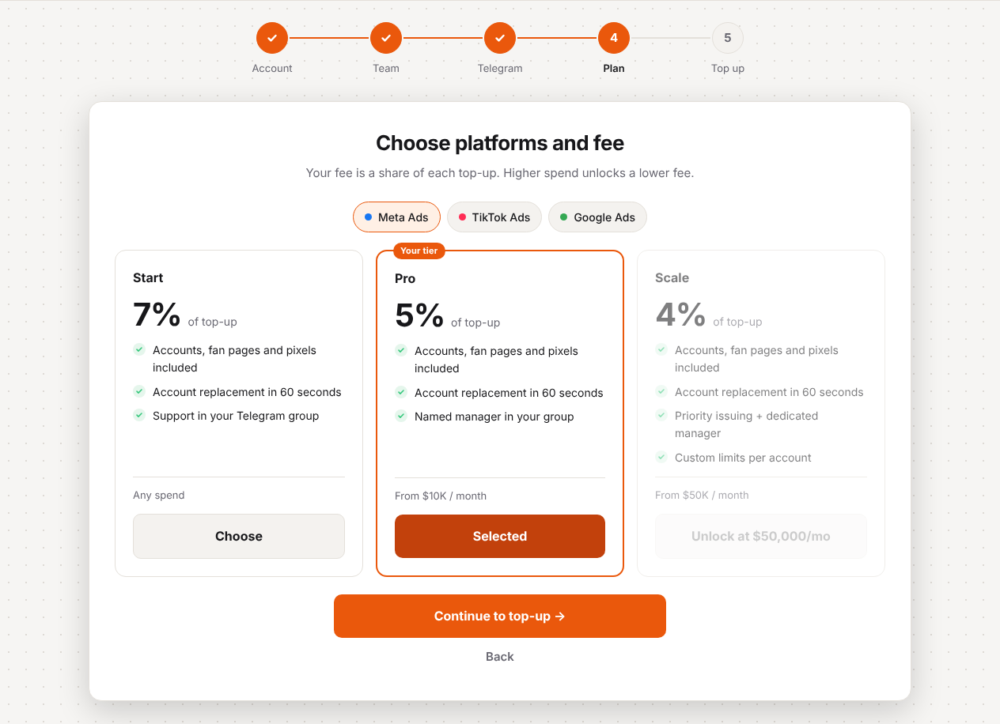

| | |
|---|---|
| Mục đích | Chọn nền tảng và mức phí |
| Thành phần | Chọn nhiều nền tảng (Meta, TikTok, Google); 3 thẻ mức phí Start 7% / Pro 5% / Scale 4% |
| Quy tắc | Mức chưa đủ chi tiêu bị khoá, nút ghi "Unlock at $X/mo"; mức cao nhất đủ điều kiện có nhãn "Your tier"; phải chọn ít nhất 1 nền tảng |
| Cần chốt | Ngưỡng $10K / $50K và nội dung từng mức là **giả**; landing chỉ nói "4–7%" |
| Sự kiện | `plan_viewed`, `plan_selected` (kèm `tier`, `platforms`) |

#### W5. Nạp tiền lần đầu

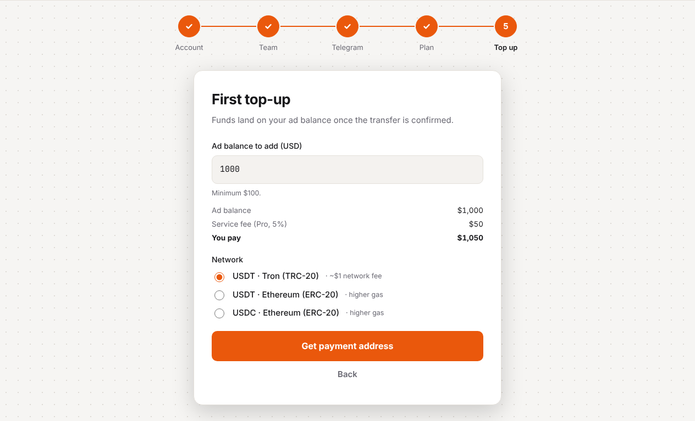

| | |
|---|---|
| Mục đích | Chọn số tiền và mạng thanh toán |
| Thành phần | Ô số tiền; bảng tính (số dư nhận được, phí, tổng phải trả); chọn mạng USDT TRC-20 / USDT ERC-20 / USDC ERC-20 |
| Quy tắc | Tối thiểu $100 (**giả**); phí = số tiền × mức phí; TRC-20 là mặc định vì phí mạng thấp |
| Sự kiện | `topup_form_viewed`, `invoice_created` (kèm `amount`, `network`) |

#### W6. Hoá đơn crypto

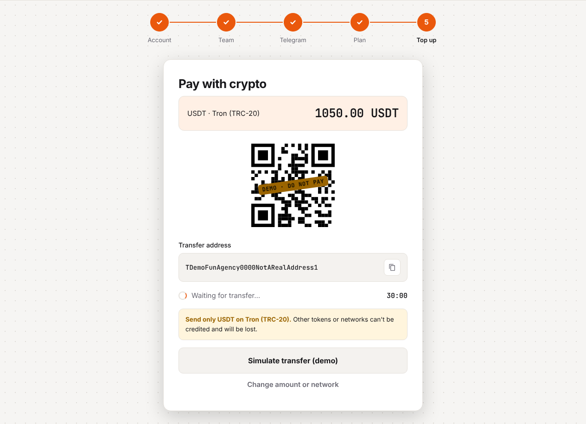

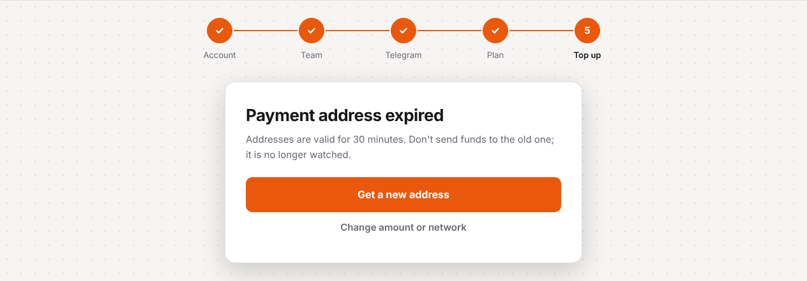

| | |
|---|---|
| Mục đích | Cho khách địa chỉ và số tiền chính xác để chuyển |
| Thành phần | Tổng phải trả; QR; địa chỉ có nút copy; đồng hồ 30 phút; cảnh báo chỉ gửi đúng token và đúng mạng |
| Trạng thái | Chờ chuyển → đã thấy giao dịch, đang xác nhận (x/19) → xong, sang W7; hết 30 phút → màn "Payment address expired" và nút tạo địa chỉ mới |
| Hệ thống | Mỗi hoá đơn một địa chỉ riêng; theo dõi blockchain tự xác nhận |
| Sự kiện | `invoice_viewed`, `address_copied`, `payment_detected`, `payment_confirmed`, `invoice_expired` |

#### W7. Hoàn tất

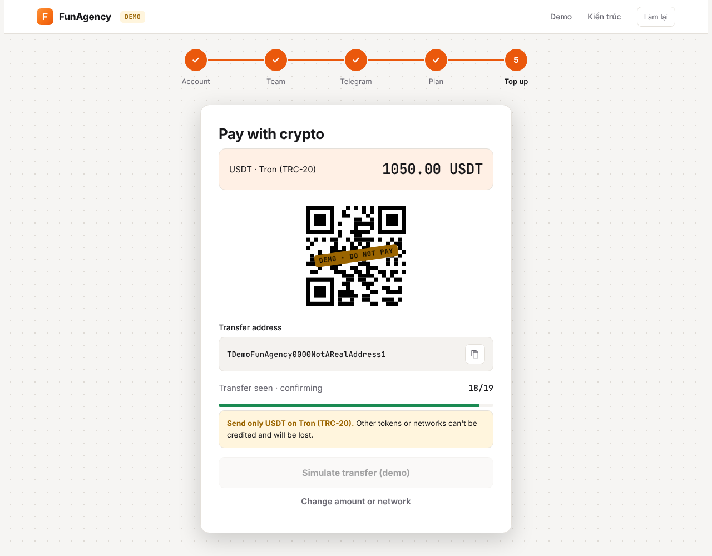

| | |
|---|---|
| Mục đích | Xác nhận đã nhận tiền; đưa khách vào kênh hỗ trợ; giới thiệu chương trình giới thiệu |
| Thành phần | Thẻ nhóm hỗ trợ (người phụ trách, tài khoản Support, bot) với nút mở nhóm; dòng nói rõ bot đọc tin nhắn trong nhóm; thẻ giới thiệu kèm link copy |
| Ghi chú | Tương đương cửa sổ upsell "One step left" của Cabinet, nhưng FunAgency mời làm người giới thiệu thay vì bán thêm |
| Sự kiện | `onboarding_completed`, `support_group_opened`, `ref_link_copied` |

#### W8. Dashboard: tài khoản quảng cáo

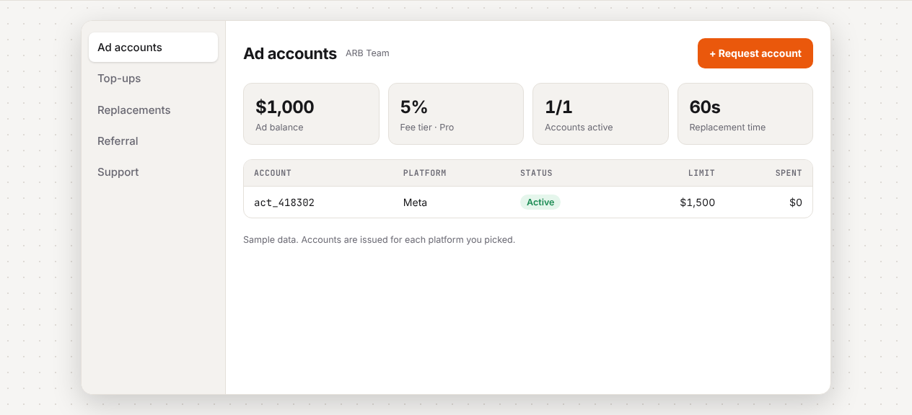

| | |
|---|---|
| Mục đích | Khách tự xem số dư, mức phí, tài khoản và trạng thái |
| Thành phần | 4 ô số (số dư, mức phí, tài khoản đang chạy, thời gian thay); bảng tài khoản (ID, nền tảng, trạng thái, hạn mức, đã chi); nút "Request account" |
| Trạng thái tài khoản | Issuing (nhấp nháy) → Active; sau này thêm Banned → Replaced |
| Menu | Ad accounts, Top-ups, Replacements, Referral, Support. Top-ups và Replacements chưa có trong demo |
| Sự kiện | `dashboard_viewed`, `account_requested` |

#### W9. Giới thiệu

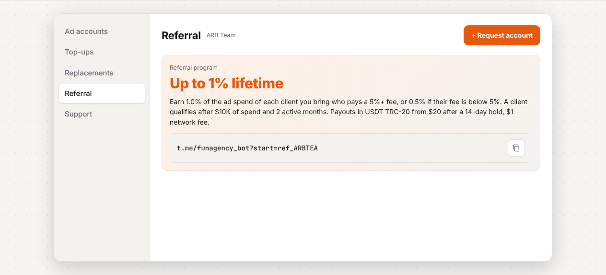

| | |
|---|---|
| Mục đích | Biến khách thành người giới thiệu |
| Nội dung | Đúng `terms.html`: 1.0% chi tiêu của khách được giới thiệu nếu phí của khách ≥ 5%, 0.5% nếu dưới 5%; tính sau $10K chi tiêu và 2 tháng; giữ 14 ngày; rút từ $20 bằng USDT TRC-20, phí mạng $1 |
| Sự kiện | `ref_link_copied` |

#### W10. Hỗ trợ

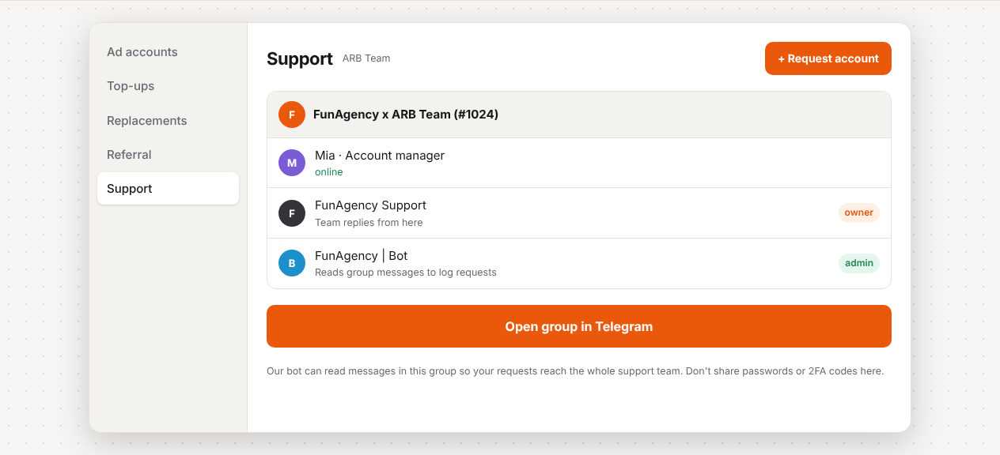

| | |
|---|---|
| Mục đích | Một chỗ để khách mở lại kênh hỗ trợ |
| Thành phần | Thông tin nhóm hỗ trợ và thành viên, nút mở trên Telegram, nhắc không gửi mật khẩu hay 2FA |

### 6.3 Bot (phía khách)

Ảnh dưới đây dùng **đúng nội dung** trong `bot/src/texts.js`. Riêng các câu trả lời của nhân viên là ví dụ.

#### B1. `/start`

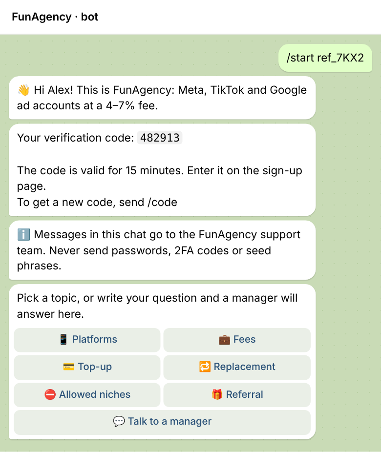

| | |
|---|---|
| Thứ tự tin | Lời chào → mã 6 số (15 phút) → cảnh báo bảo mật (chỉ lần đầu) → menu 6 chủ đề và nút gặp quản lý |
| Quy tắc | `/start ref_XXX` lưu mã ref lần đầu, không ghi đè; khách tiếng Nga nhận tiếng Nga |
| Phía nhân viên | Mở topic cho khách, ghi "▶️ /start · ref XXX" |

#### B2. Tự tư vấn (FAQ)

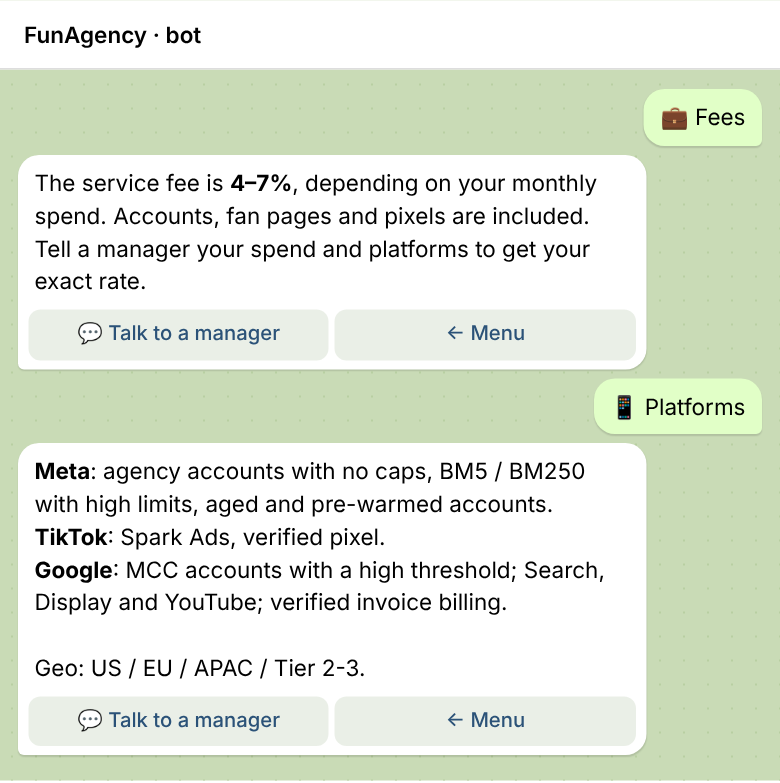

| | |
|---|---|
| Chủ đề | Platforms, Fees, Top-up, Replacement, Allowed niches, Referral |
| Mỗi câu trả lời | Có nút "Talk to a manager" và "← Menu" |
| Phía nhân viên | Ghi "👀 Opened FAQ: …" vào topic nếu đã có |
| Cần chốt | Nội dung Top-up đang chung chung vì chưa có phương thức và mức tối thiểu |

#### B3. Hỏi người thật

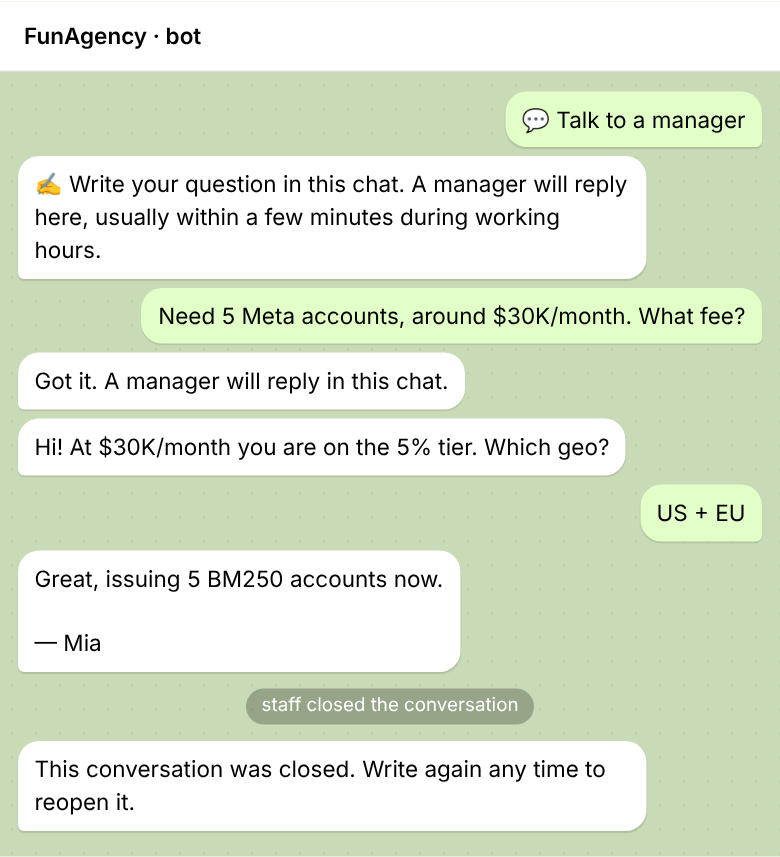

| | |
|---|---|
| Luồng | Bấm "Talk to a manager" hoặc nhắn thẳng → tin đầu nhận "Got it…" → câu trả lời của nhân viên tới **dưới tên bot** → có thể có chữ ký "— Mia" nếu nhân viên bật `/alias` |
| Đóng | Nhân viên `/close` thì khách nhận "This conversation was closed…"; khách nhắn lại là mở lại |

#### B4. Lấy lại mã và liên kết xong

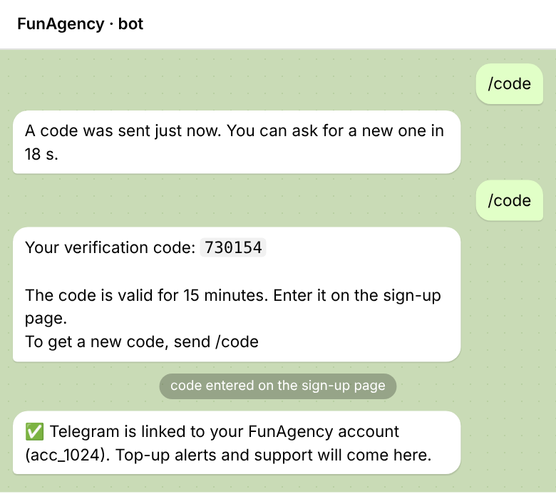

| | |
|---|---|
| Quy tắc | `/code` cách nhau ít nhất 30 giây, bot báo còn bao nhiêu giây; mã mới làm mã cũ hết hiệu lực |
| Liên kết | Web xác nhận mã thì bot nhắn "Telegram is linked to your FunAgency account (acc_…)" |

### 6.4 Nhóm nhân viên

#### S1. Topic của một khách

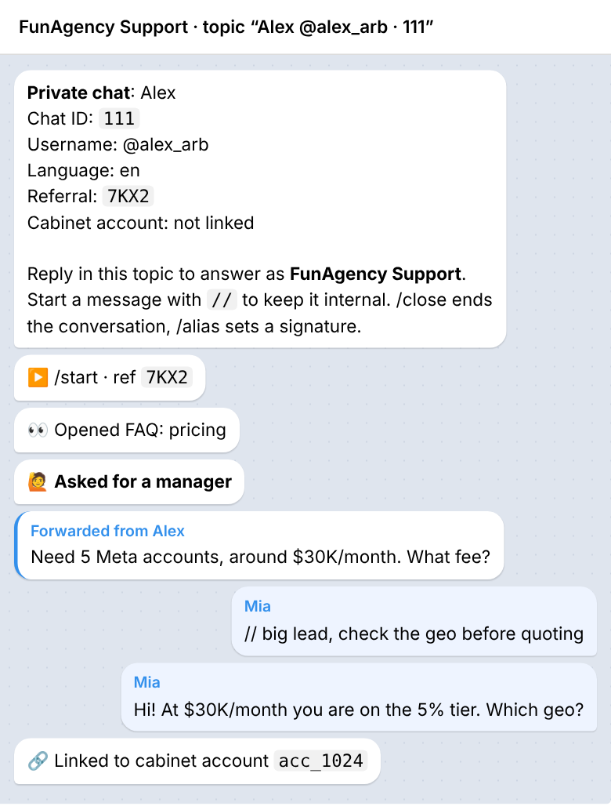

| | |
|---|---|
| Đầu topic | Thẻ thông tin: chat, ID, username, ngôn ngữ, mã ref, tài khoản web, hướng dẫn |
| Dòng sự kiện | `/start` kèm ref, FAQ đã mở, bấm gặp quản lý, đã liên kết web |
| Tin của khách | Hiện dạng "Forwarded from …" |
| Nhân viên viết | Gửi cho khách; bắt đầu bằng `//` là ghi chú nội bộ |
| Lệnh | `/close`, `/info`, `/faq <chủ đề>`, `/alias <tên>` / `/alias off` |

#### S2. Gửi thất bại và đóng

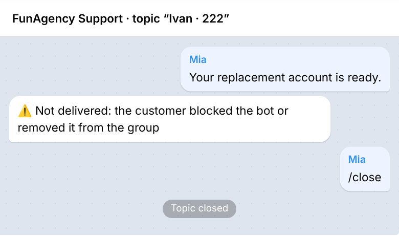

| | |
|---|---|
| Gửi thất bại | Khách chặn bot hoặc xoá bot khỏi nhóm thì topic hiện "⚠️ Not delivered: …" |
| Đóng | `/close` đóng topic và báo khách |

## 7. User story và tiêu chí nghiệm thu (bot)

Các màn web đã có tiêu chí trong bảng ở mục 6.2.

**US1. Lấy mã đăng ký:** khách nhận mã từ bot để liên kết web.
- `/start` trả lời chào, mã, cảnh báo (lần đầu), menu.
- Mã dùng được 15 phút, một lần.
- `/code` cấp mã mới, mã cũ hết hiệu lực.
- Xin lại trong 30 giây thì bot báo phải chờ, không im lặng.

**US2. Ghi nhận người giới thiệu.**
- `/start ref_ABC` lưu `ABC`.
- Bấm link ref khác sau đó vẫn giữ mã đầu.
- Mã ref hiện trong topic và trả về cho web.

**US3. Tự tư vấn.**
- 6 chủ đề cùng nút gặp quản lý, EN/RU theo Telegram của khách.
- Số liệu khớp landing và `terms.html`.

**US4. Hỏi người thật.**
- Mọi loại tin tới nhóm nhân viên.
- Trả lời tới từ bot, khách không thấy tài khoản nhân viên.
- Reply giữ đúng tin đang trả lời ở cả hai phía.

**US5. Trả lời ẩn danh.**
- Mỗi khách một topic, có thẻ thông tin.
- `//` không gửi đi.
- Admin ẩn danh trả lời được.
- Gửi thất bại có cảnh báo.
- `/alias` ký tên.

**US6. Đóng hội thoại.** `/close` đóng và báo khách; khách nhắn lại thì mở lại.

**US7. Liên kết web.**
- `POST /verify` mã đúng trả `tg_id`, `username`, `first_name`, `ref_code`.
- Mã sai hoặc đã dùng trả 400; sai khoá trả 401.
- Thành công thì bot báo khách và topic.

## 8. Luồng chính

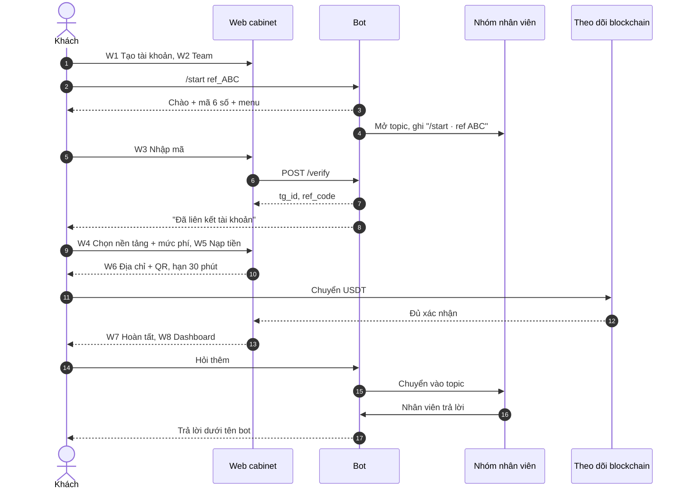

## 9. Thiết kế kỹ thuật: bot (đã làm)

**Công nghệ:**
- Node.js 22.13 trở lên.
- [grammY](https://grammy.dev), chạy long polling nên không cần URL công khai.
- SQLite có sẵn trong Node (`node:sqlite`), file `data/bot.db`.

| File | Nhiệm vụ |
|---|---|
| `bot/src/index.js` | Khởi động bot và API, đăng ký lệnh, dừng an toàn |
| `bot/src/config.js` | Đọc biến môi trường, thiếu biến bắt buộc thì dừng |
| `bot/src/db.js` | Schema và truy vấn SQLite |
| `bot/src/otp.js` | Cấp và kiểm tra mã 6 số |
| `bot/src/texts.js` | Toàn bộ nội dung gửi khách, EN và RU |
| `bot/src/relay.js` | Chuyển tin khách ↔ nhóm nhân viên |
| `bot/src/bot.js` | Gắn lệnh, nút, tin nhắn vào các module |
| `bot/src/api.js` | HTTP API cho web cabinet |
| `bot/test/` | 32 test, chạy `npm test` |

**Cơ chế ẩn danh:**
- Khách → nhân viên dùng `forwardMessage`, để nhân viên thấy ai viết.
- Nhân viên → khách dùng `copyMessage`, bản sao không mang người gửi gốc nên khách chỉ thấy bot.
- Có alias thì dùng `sendMessage`, nối chữ ký vào cuối; định dạng giữ nguyên.

**Dữ liệu:**

| Bảng | Nội dung |
|---|---|
| `users` | `tg_id`, username, tên, ngôn ngữ, `ref_code` (lần đầu), `account_id` (web) |
| `codes` | mã, `tg_id`, hạn, thời điểm dùng |
| `conversations` | `chat_id`, loại, tiêu đề, `topic_id`, trạng thái |
| `msg_links` | cặp ID tin phía khách ↔ phía nhân viên |
| `staff_aliases` | chữ ký của từng nhân viên |

**API:**

```
POST /verify
Authorization: Bearer <API_SECRET>
{"code": "482913", "account_id": "acc_1024"}
→ 200 {"ok": true, "tg_id": 111, "username": "alex_arb", "first_name": "Alex", "ref_code": "7KX2"}
→ 400 {"ok": false, "error": "invalid_or_expired_code"}
→ 401 {"ok": false, "error": "unauthorized"}
GET /health → 200
```

**Cài đặt và vận hành:**
- Biến môi trường: xem `bot/.env.example`.
- Tắt Group Privacy của bot nếu muốn đọc tin trong nhóm khách.
- Nhóm nhân viên là supergroup bật Topics; bot là admin có quyền *Manage topics*.
- Chạy một instance.
- Sao lưu `data/bot.db` hằng ngày.
- API chỉ mở cho backend web, qua HTTPS.
- `.vercelignore` loại `bot/` và `docs/` khỏi bản deploy landing.

## 10. Thiết kế kỹ thuật: web cabinet (đề xuất)

Sơ đồ đầy đủ có ở cuối trang demo (phần "Kiến trúc"). Tóm tắt:

| Khối | Việc | Gợi ý công nghệ |
|---|---|---|
| Web | Các màn W1–W10 | Next.js |
| API | Đăng nhập, team, hoá đơn, tài khoản, giới thiệu | NestJS hoặc FastAPI, Postgres |
| Thanh toán | Mỗi hoá đơn một địa chỉ (ví HD, khoá trong KMS); theo dõi TronGrid / Etherscan; 19 xác nhận trên TRON; sổ kế toán bút toán kép | Worker + Redis |
| Cấp tài khoản | Gọi Meta / TikTok / Google, thay tài khoản | Worker |
| Bot | Đã có, nối qua `POST /verify` | |

## 11. Quy tắc nghiệp vụ

| Quy tắc | Giá trị | Ở đâu |
|---|---|---|
| Mã | 6 chữ số, 15 phút, 1 lần, cách nhau 30 giây | `bot/src/otp.js`, `OTP_TTL_MIN` |
| Người giới thiệu | Lần đầu, không ghi đè | `bot/src/db.js` |
| Ghi chú nội bộ | Bắt đầu bằng `//` | `bot/src/relay.js` |
| Ngôn ngữ bot | RU nếu Telegram là `ru*`, còn lại EN | `bot/src/texts.js` |
| Phí dịch vụ | 4–7% | landing, `texts.js` |
| Ngưỡng từng mức phí | $10K / $50K (**giả**) | demo W4 |
| Nạp tối thiểu | $100 (**giả**) | demo W5 |
| Hạn hoá đơn | 30 phút | demo W6 |
| Thay tài khoản | khoảng 60 giây | landing, `texts.js` |
| Hoa hồng giới thiệu | 1.0% nếu phí khách ≥ 5%, 0.5% nếu dưới; sau $10K và 2 tháng; giữ 14 ngày; rút từ $20, phí $1 | `terms.html`, `getRate()` trong `index.html`, `texts.js`, demo W9 |

Đổi một con số thì đổi mọi nơi trong cột cuối. Test của bot kiểm tra phần hoa hồng khớp `terms.html`.

## 12. Trạng thái và backlog

**Đã xong:**
- Bot: toàn bộ mục 7, có 32 test (9 test chạy handler thật với tin nhắn giả lập).
- Demo web W1–W10.

**Chưa kiểm tra:** bot chưa chạy với Telegram thật.

| # | Việc | Ai | Ghi chú |
|---|---|---|---|
| 1 | Chạy bot với token và nhóm nhân viên thật, kiểm tra mục 7 bằng tay | Dev + hỗ trợ | |
| 2 | Chuyển hỗ trợ từ `@nil_ad01` sang bot | Business | Báo khách cũ, sửa link landing |
| 3 | Đo phễu theo các sự kiện ở mục 6 | Dev + BA | BA chốt tên sự kiện |
| 4 | Web W1–W3 + `POST /verify` | Dev | |
| 5 | Thanh toán W4–W6 | Dev | Cần chốt mục 13 |
| 6 | Dashboard W7–W10, thông báo nạp tiền qua bot | Dev | |
| 7 | Tự tạo nhóm riêng cho từng khách | Dev | Cần tài khoản người dùng chạy MTProto; rủi ro bị Telegram giới hạn |
| 8 | Gửi lại tin khi khách sửa tin nhắn | Dev | Nhỏ |

## 13. Câu hỏi cần chốt

1. **Tên bot:** `@funagency_bot` hay tạo bot mới?
2. **Giờ trực và SLA;** ngoài giờ có tự trả lời không?
3. **Ký tên:** trả lời hoàn toàn ẩn danh, hay mỗi khách có một người phụ trách có tên?
4. **Ai được vào nhóm nhân viên,** ai xem được lịch sử?
5. **Lưu tin nhắn và dữ liệu khách bao lâu.** README landing ghi chưa đáp ứng 152-FZ (lưu dữ liệu công dân Nga tại Nga).
6. **Ngưỡng chi tiêu cho từng mức phí** trong khoảng 4–7%.
7. **Phương thức nạp và mức tối thiểu;** có nhận ERC-20 và USDC không?
8. **Hạn mức tài khoản theo mức phí.**
9. **Khách cũ ở `@nil_ad01`** chuyển sang thế nào?
10. **Cửa sổ W7:** mời làm người giới thiệu hay ưu tiên nội dung khác?

## 14. Rủi ro

| Rủi ro | Giảm thiểu |
|---|---|
| Khách gửi mật khẩu hoặc mã 2FA vào chat | Cảnh báo ở bot và W7/W10; nhân viên không bao giờ hỏi |
| Khách gửi sai mạng hoặc sai token | Chỉ hiện mạng đã chọn, cảnh báo rõ, kiểm tra contract token |
| Lộ khoá API | Khoá dài ngẫu nhiên, chỉ backend gọi, qua HTTPS |
| Lộ khoá ví | KMS, gom tiền về ví lạnh theo lịch |
| Bot là một điểm hỏng duy nhất | Theo dõi `/health`, tự khởi động lại, sao lưu DB |
| Nhân viên lỡ gửi ghi chú cho khách | Quy ước `//`, nhắc trong thẻ thông tin topic |
| Số liệu lệch giữa landing, điều khoản, bot, web | Bảng mục 11, test |

## 15. Thuật ngữ

- **Topic:** chủ đề con trong supergroup Telegram bật Topics; mỗi khách một topic.
- **Ref / first-touch:** mã người giới thiệu; first-touch là giữ mã của lần đầu khách bấm.
- **OTP:** mã dùng một lần.
- **Ẩn danh:** khách chỉ thấy bot, không thấy tài khoản nhân viên trả lời.
- **Web cabinet:** trang web khách đăng nhập để quản lý tài khoản và nạp tiền.
- **Xác nhận (confirmation):** số khối blockchain sau giao dịch; đủ số thì coi là chắc chắn.
